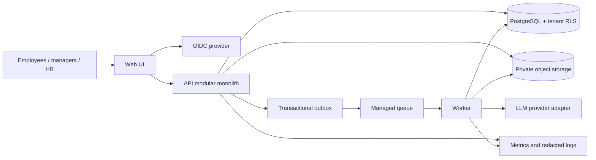
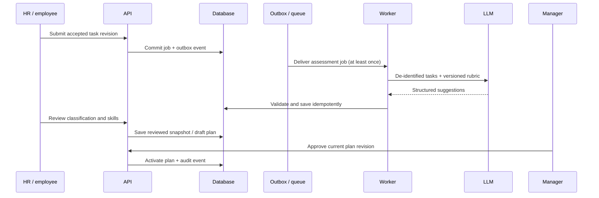
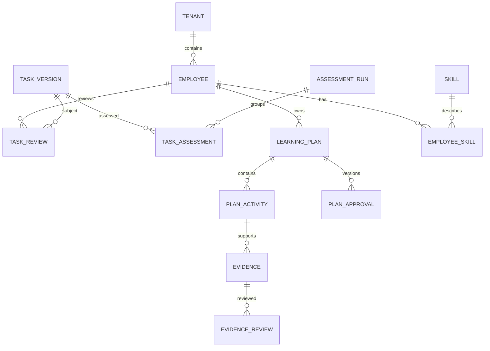

# High-level design

## Architecture and sizing assumptions

Use a modular monolith: Next.js/TypeScript web UI, a NestJS/TypeScript API, PostgreSQL, an asynchronous worker using a managed queue, and private S3-compatible object storage. An external OIDC provider supplies identity. An LLM API is called through a provider adapter with strict structured outputs. Deploy API and worker as separate containers from the same repository, with one database and explicit module ownership. Redis, vector databases and microservices are unnecessary initially.

Planning envelope, not PRD commitments: two pilot tenants, up to 1,000 employees each, 20 tasks per employee, 50 concurrent sessions; CSV limited initially to 5,000 rows / 10 MB. Confirm with design partners. Chunk larger runs into bounded jobs; benchmark before offering larger imports.

## Modules and trust boundaries

| Module | Responsibility |
|---|---|
| Identity and tenancy | OIDC sessions, memberships, employee/manager relationships, tenant policy |
| Inventory | Import preview/confirmation, roles, versioned tasks and employee corrections |
| Assessment | Rubric execution, AI suggestions, confidence and human decisions |
| Skills | Versioned taxonomy, role targets, self-reports and verified evidence |
| Learning | Curated resources, 30-day plan generation, approval and progress |
| Evidence | Upload quarantine, malware scanning, rubric review and verification |
| Reporting | Tenant-scoped aggregates, adoption funnel, completion and verification |
| Audit and jobs | Append-only audit events, outbox, retry, cancellation and cost budgets |

Browser input, imported CSV, uploaded evidence and model output are untrusted. Tenant context comes from authenticated membership, never a client-supplied tenant identifier alone. The model cannot invoke tools, fetch arbitrary URLs, approve records or execute code.

## Core workflows

1. HR uploads a CSV to quarantine. API validates headers, encoding, row count, role/task references and duplicate external IDs. Preview shows row errors without committing inventory. Confirm valid import atomically; unique `(tenant_id, import_digest)` and external-ID constraints prevent duplicate writes. CSV cells are escaped on export to prevent spreadsheet formula execution.
2. Employees review assigned task maps and propose corrections. An authorised reviewer accepts a revision; only accepted task versions enter the assessment pipeline. Preserve historical versions and mark affected assessments/plans stale after accepted corrections.
3. Assessment transaction creates a queued job and outbox event. Worker reads de-identified accepted tasks and rubric, calls provider with a bounded prompt, validates schema and persists suggestions with full provenance. Human review accepts or corrects classification. Unknown and low-confidence outputs cannot silently pass.
4. Skills gap compares role targets with explicit self-reported/verified levels. Missing information remains unknown. Curated prerequisites and employee time budget constrain a 30-day draft; model text cannot invent unavailable courses.
5. Manager reviews the current draft revision. Approval starts the plan; rejected plans return to draft with reasons. Employees complete exercises and submit scanned evidence. Reviewers verify against rubric; dashboard separates activity completion, plan completion and verified skills.

## Data model

Every domain table includes `tenant_id`, stable UUID, timestamps and revision where mutable; composite foreign keys enforce same-tenant relationships. Global catalogue/taxonomy data is read-only to tenants with separately versioned tenant overrides.

| Entity | Main data / constraints |
|---|---|
| Tenant, Membership, Employee, ManagerAssignment | OIDC subject, membership role, scoped employee relationships; no reliance on email as immutable ID |
| Role, RoleVersion, TaskVersion, EmployeeTaskReview | External IDs unique per tenant; immutable accepted versions and explicit review states |
| ImportBatch, ImportRowError | Digest, status, counts, protected object key, errors and actor |
| AssessmentRun, TaskAssessment, AssessmentReview | Task version, category, rationale, confidence label, rubric/prompt/model versions, human override and reasons |
| Skill, RoleSkillTarget, EmployeeSkill | Versioned taxonomy and target level; proficiency source = self-report or evidence; unknown allowed |
| LearningPlan, PlanActivity, PlanApproval | Employee, assessment snapshot, revision, time budget, status, start/end dates, approving actor and revision |
| Evidence, EvidenceReview, SkillVerification | Object key, scan state, rubric revision, reviewer decision and expiry if applicable |
| Job, OutboxEvent, AuditEvent | Idempotency key, lease/retry state, event payload, actor, resource and redacted change metadata |

## API outline

Version under `/v1`; validate schemas; use cursor pagination. Return consistent problem details with error code, field errors and request ID, without PII. Require idempotency keys for import confirmation, job creation and evidence submission. Use ETags/If-Match for reviews and approvals; stale revisions return 409/412. Async calls return 202 and a job URL.

| Endpoint | Authorised actor / effect |
|---|---|
| POST /imports; GET /imports/{id}; POST /imports/{id}/confirm | HR/admin: upload preview and atomic confirmation |
| GET /me/tasks; POST /tasks/{id}/reviews | Employee for own records; reviewer accepts corrections through scoped permission |
| POST /assessment-runs; GET /jobs/{id} | HR/scoped reviewer: assess accepted versions and inspect tenant job |
| GET /assessments/{id}; POST /assessments/{id}/reviews | Employee reads own; authorised reviewer accepts/corrects |
| GET /me/skills; PUT /me/skills/{id} | Employee self-report; cannot self-verify |
| POST /learning-plans; GET /learning-plans/{id} | Generate/read within employee or assigned-manager scope |
| POST /learning-plans/{id}/approvals | Assigned manager approves exact revision; requester cannot bypass assignment |
| POST /activities/{id}/evidence; POST /evidence/{id}/reviews | Employee submits own; designated reviewer verifies |
| GET /reports/progress | Manager sees assigned team; HR sees permitted tenant aggregates |
| POST /privacy-requests | Authorised privacy workflow for export/deletion, with tracked completion |

## AI and queue reliability

Use a rubric with proposed categories `assist`, `partially_automate`, `human_led`, `uncertain`; these describe tasks, never employee worth or predicted job loss. Confidence labels require benchmark calibration; raw model self-confidence must be labelled uncalibrated and routed for review until validated. Store rationale and input/output hashes, not private chain-of-thought.

Job states: queued → running → succeeded / retry_wait / failed / cancelled. At-least-once delivery requires a unique `(tenant_id, job_type, input_version, rubric_version)` key and transactional output upsert. Leases recover abandoned work. Retry transient provider failures with exponential backoff/jitter, maximum five attempts; permanent schema failures are bounded and then reviewed. Dead-letter exhausted jobs and alert operators. An outbox poller recovers publication failures; acknowledge queue only after durable result commit.

Reject outputs referencing unknown tasks/skills, unsupported categories, invalid confidence or excessive length. Do not pass raw evidence files to the model in the MVP. Treat task text as data against prompt injection; no external tools. Apply per-tenant token/concurrency budgets, provider timeouts, cancellation and circuit breaker. Provider outage leaves manual review available and does not activate plans. Pin rubric/model/prompt versions and evaluate before changing any of them.

## Security and privacy

Use OIDC auth-code + PKCE, secure HttpOnly sessions, CSRF protection for cookie-authenticated writes, CSP, TLS and managed encryption at rest. Enforce role and resource authorisation in API and worker. PostgreSQL RLS uses transaction-local tenant context on a non-owner, non-BYPASSRLS application role with FORCE RLS; connection pooling must not leak context. Test same-role and cross-role tenant isolation and object storage access.

Employees see their own records; managers see assigned employees; HR manages inventory and scoped aggregates; administrators manage policy; reviewers access only assigned evidence. Explicitly decide whether HR can see individual skill evidence. Signed upload/download URLs expire quickly and are issued only after authorisation. Quarantine uploads, validate MIME/size, scan for malware, block public ACLs and unsafe document rendering.

Send only necessary de-identified task text to an approved provider; task descriptions themselves may contain PII and require redaction. No training on employee data without an approved contract. Secrets stay in a secret manager. Redact telemetry and append audit records for imports, overrides, access-sensitive actions and approvals. Proposed retention: raw import 30 days, evidence 180 days after plan end, domain records for contract duration; all require customer/legal approval. Deletion covers DB, objects, caches, derived records and vendor data; backups expire on a documented schedule with deletion reapplied after restore. Minimal audit metadata has a separately approved retention/legal-hold policy.

## Deployment and operational targets

Separate dev/staging/production, private DB/object storage, managed queue, container API/worker behind managed ingress, IaC and secret manager. Prefer one region selected by customer data requirements, managed PostgreSQL with PITR, and automated migrations with expand/contract compatibility. CI checks types, lint, unit/integration/security tests and builds immutable images; staging smoke tests precede production approval. Roll back images while retaining backward-compatible schema.

Proposed pilot SLOs: 99.5% monthly API availability; p95 ordinary reads <500 ms at assumed load; 95% of 100-task assessment batches finish within 10 minutes when provider is healthy. Import preview <30 seconds at the defined cap. Measure separately from provider downtime; include provider-driven customer failures in end-to-end availability. Proposed RPO 24 hours / RTO 8 hours, to be accepted by buyers; rehearse restore before pilot. Use PITR plus daily backups and test recoverability.

Monitor API latency/errors, queue age, dead letters, outbox lag, provider failures, cost per task/tenant, invalid AI output, review disagreement and adoption funnel. Alert on sustained errors, queue age >10 minutes, budget exhaustion and failed backups. Runbooks cover provider outage, stuck imports, tenant leak, malware upload, restore and data deletion. No infrastructure spend commitment until region, provider and actual benchmark costs are known.

## Validation strategy

Unit tests for state transitions, gap calculation and metric denominators; integration tests for atomic imports, RLS, outbox recovery, duplicate jobs and stale approvals; contract tests for malformed provider output; end-to-end employee→manager→evidence flow; accessibility checks against WCAG 2.2 AA. Security tests include direct object ID access, cross-tenant exports and signed URLs. Evaluate five representative roles with expert-labelled tasks and adversarial descriptions; obtain agreed thresholds before production. Load-test the planning envelope and rehearse backup restore/deletion. These tests are planned, not executed application tests.
